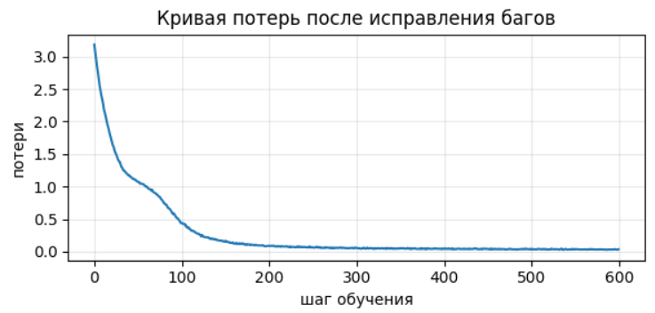

# Как воспроизвести результаты (seed = 42):
1. Открыть dz1_attention.ipynb с помощью google colab, там готовое окружение для запуска кода. 
2. Запустить все ячейки сверху вниз - в итоге в конце все проверки будут пройдены (17 из 17). 
3. Открыть dz1_bughunt.ipynb аналогично с помощью google colab.
4. Запустить все ячейки сверху вниз. В коде помечены строчки, в которых сделаны исправления, а также есть таблица с пояснениями по исправлениям семантических ошибок
5. В итоге в конце обучение выполняется 600 шагов: в сохранённом прогоне потери снизились 3.184 -> 0.037

# Результаты
Результаты представлены в ipynb, продублирую здесь

## Пояснение к dz1_attention TODO 3:   
В todo 3 третье решение (применение маски) показалось мне наиболее неочевидным, поскольку важно было понять, как это повлияет на softmax. Ошибка в маскировании может не вызывать ошибок размерности или вычислений, но при этом нарушать принцип причинности Transformer и будет происходить утечка информации из будущих токенов, которую модель сможет использовать

## Результаты dz1_bughunt
### Отчёт о найденных ошибках
| # | Функция и строка | Механизм поломки | Как исправили |
|---|---|---|---|
| 1 | sinusoidal_positional_encoding | Отсчёт позиций начинается с 1 вместо 0. Вычисление sin/cos компонент для нерпавильных позиций | Заменил начало диапазона с 1 на 0: torch.arange(0, length, ...) |
| 2 | LayerNorm.forward | Среднее и дисперсия вычисляются по оси dim=0, то есть по элементам батча, а не по признакам отдельного токена | Заменил dim=0 на dim=-1 при вычислении среднего и дисперсии |
| 3 | scaled_dot_product_attention | Softmax применяется по оси dim=-2, то есть по запросам, вместо оси ключей. В результате нормируются столбцы матрицы внимания | Заменил dim=-2 на dim=-1, чтобы softmax нормализовал веса по ключам отдельно для каждого запроса |

Подробное пояснение:    
1. sinusoidal_position_encoding - Отсчёт позиций начинается с 1 вместо 0. Из-за этого первый токен получает позиционное кодирование второй позиции относительно ожидаемой нумерации. Синусные и косинусные компоненты вычисляются для неправильных индексов   
2. LayerNorm.forward - Среднее и дисперсия вычисляются по оси dim=0, то есть по элементам батча, а не по признакам отдельного токена. В результате нормализация одного токена начинает зависеть от других примеров в батче. Это нарушает принцип Layer Normalization: каждый токен должен нормализоваться независимо по своей размерности признаков   
3. scaled_dot_product_attention - Softmax применяется по оси dim=-2, то есть по запросам, вместо оси ключей. В результате нормируются столбцы матрицы внимания, хотя каждый запрос должен самостоятельно распределять вероятности между доступными ключами. Сумма весов в каждой строке перестаёт быть равной единице, поэтому модель неправильно взвешивает векторы value

### График потерь


### Сгенерированный текст
```
алгоритм внимания смотрит на все позиции сразу. алгоритм внимания смотрит на все позиции сразу. алгоритм внимания смотрит на все позиции сразу. алгоритм внимания смотрит на все позиции сразу. алгоритм
```